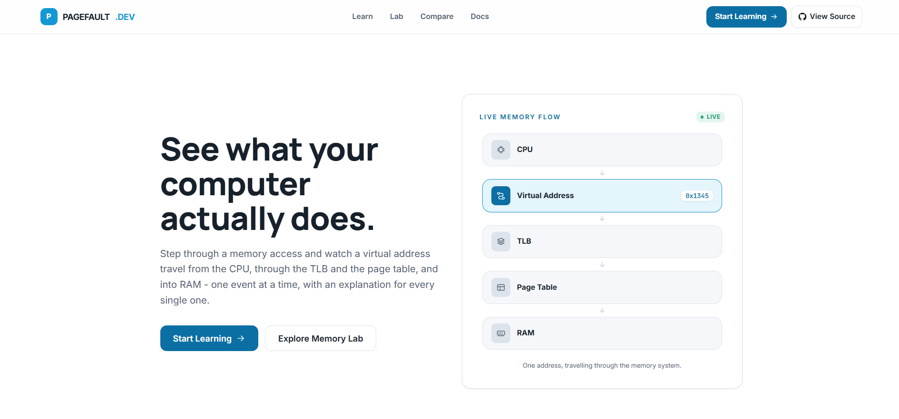
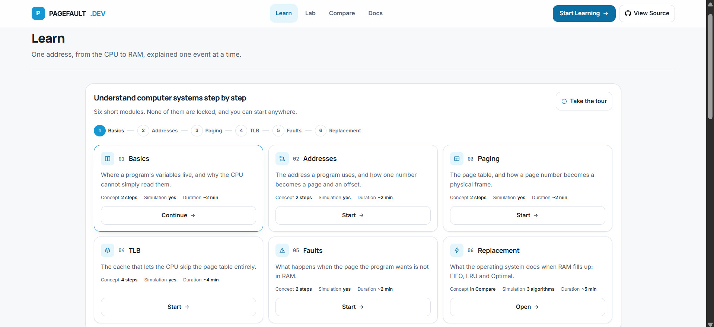
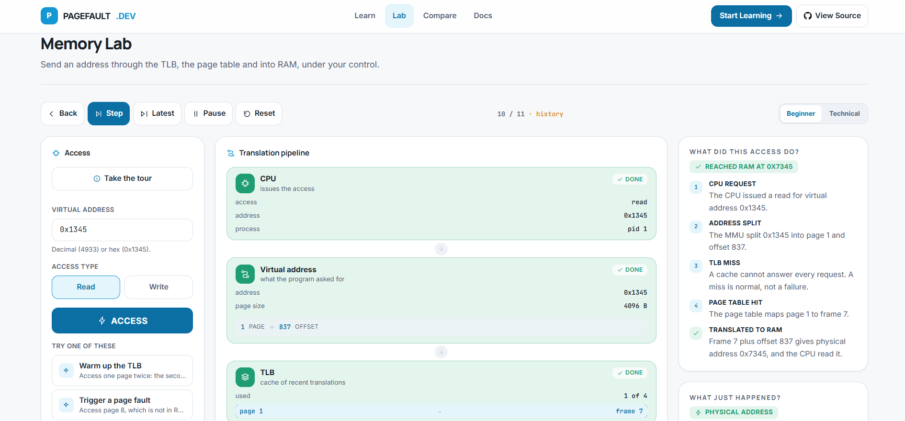
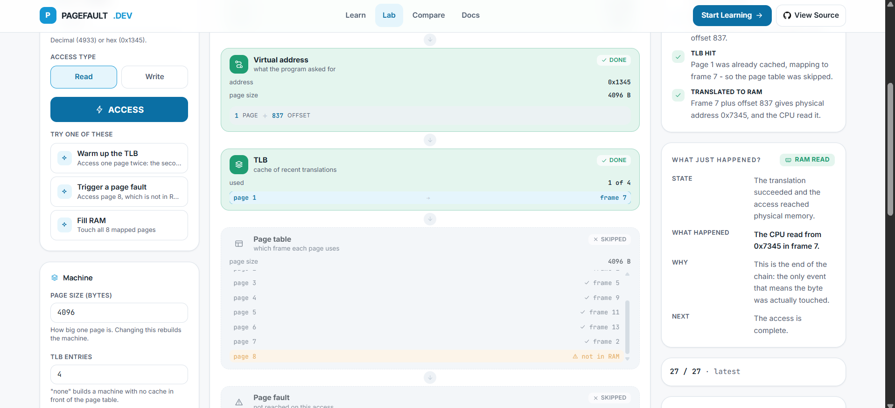
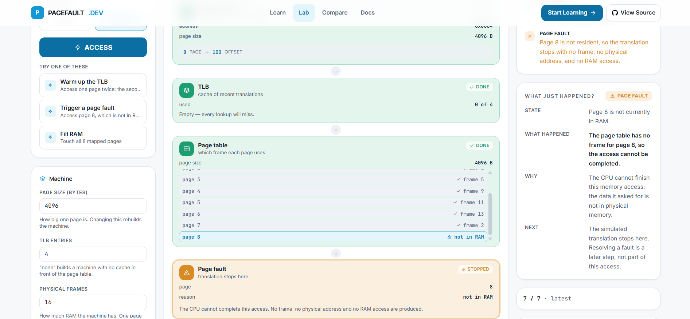
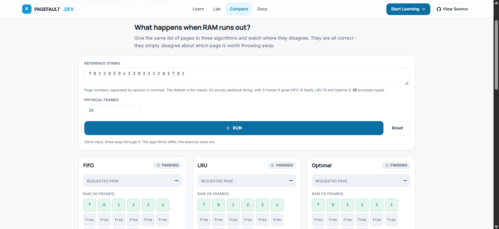
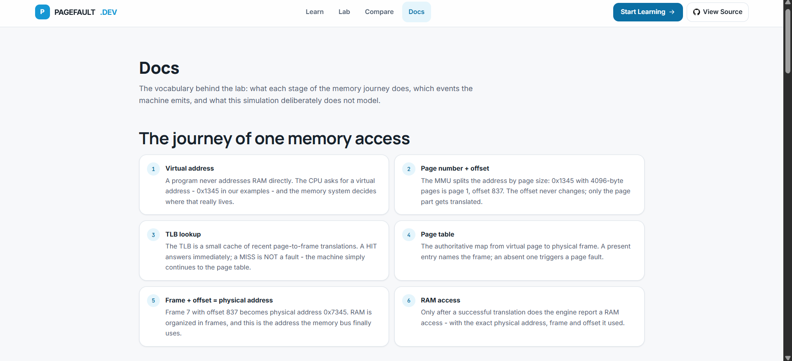
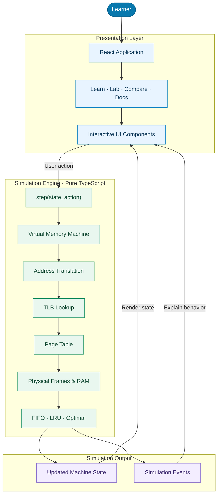

# PAGEFAULT.DEV

**Don't just learn how computers work. Watch memory work.**

[](https://github.com/avinashsingh539/PAGEFAULT.DEV/actions/workflows/ci.yml)

An interactive virtual memory laboratory that makes operating-system memory management observable and experimentally verifiable. Send a virtual address through the CPU → TLB → page table → frame → RAM pipeline, step through every event, compare FIFO, LRU, and Optimal page replacement side by side, and follow a twelve-step guided lesson — all driven by the same deterministic simulation engine.

---
<p align="center">
  <a href="https://pagefault-dev.vercel.app/">
    <strong>🚀 Live Demo</strong>
  </a>
  &nbsp;·&nbsp;
  <a href="https://github.com/avinashsingh539/PAGEFAULT.DEV">
    View Source
  </a>
</p>

## Screenshots

**Landing page**



**Memory Lab — desktop (1280px)**



**Translation pipeline with narration**



**TLB hit narration**



**Page fault narration**



**Guided learning — Learn mode**



**Concept documentation — Docs page**




## What PAGEFAULT.DEV does

PAGEFAULT.DEV is an interactive computer-systems laboratory focused exclusively on virtual memory. Instead of reading about paging, TLBs, and page faults, you observe them happen:

- Send any virtual address through the CPU → TLB → page table → frame → RAM pipeline
- Watch TLB hits and misses distinguish cache behavior from page-fault behavior
- Observe page faults when a mapping is absent — translation stops before RAM is ever touched
- Compare FIFO, LRU, and Optimal page replacement on the same reference string
- Follow a twelve-step guided lesson that explains each access event by event
- Read six concept pages with educational SVG diagrams

Every number on screen comes from the simulation engine. Nothing is faked or pre-rendered.

---

## Key features

| Feature | Description |
|---|---|
| Virtual address translation | Watch any address split into page number + offset and translated to a physical address |
| Translation Lookaside Buffer | Observe TLB lookups, hits, and misses in real time |
| Page-table mappings | View present and absent page-table entries |
| Physical memory frames | See RAM organized into fixed-size frames |
| Page faults | Observe what happens when a mapping is absent — translation stops before RAM |
| FIFO page replacement | First-in, first-out eviction policy |
| LRU page replacement | Least-recently-used eviction policy |
| Optimal page replacement | Optimal (Belady's) eviction policy |
| Interactive Learn mode | A twelve-step guided lesson explaining each access event by event |
| Memory Lab | Operate the machine yourself — pick addresses, read or write, step through events |
| Compare mode | One reference string through FIFO, LRU, and Optimal side by side |
| Step-by-step replay | Step forward/back through the event stream with a persistent cursor |
| Guided first-visit tours | Overlay tours for the Lab and Learn screens |
| Concept documentation | Six concept pages with educational diagrams |

---

## How virtual memory works

Here is the step-by-step path of a single memory access:

1. **CPU request** — the program issues a virtual address (e.g. `0x1345`)
2. **Address splitting** — the MMU divides the address into a virtual page number and an offset, based on page size
3. **TLB lookup** — the Translation Lookaside Buffer is checked first for a cached translation
4. **Page-table lookup** — on a TLB miss, the page table is consulted for the frame number
5. **Physical frame** — the present mapping names the physical frame
6. **Physical address** — `frame × page size + offset` gives the final address
7. **RAM access** — the read or write occurs at the physical address

### TLB hit vs. TLB miss

A **TLB hit** means the translation is already cached: the page table lookup is skipped entirely. A **TLB miss** means the entry is not in the cache — the machine continues to the page table. A TLB miss is **not** a page fault; it only means the cache did not have the answer.

### Page fault

When the page table has no present entry for the virtual page, translation stops and a page fault is raised. No RAM access occurs for that address.

### Worked example

```
Virtual address:    0x1345
Page size:          4096 bytes
Virtual page:       1  (0x1345 ÷ 4096)
Offset:             0x345  (837 decimal — preserved unchanged)
Physical frame:     7  (from page-table entry for page 1)
Physical address:   0x7345  (7 × 4096 + 837)
```

---


## Architecture

PAGEFAULT.DEV uses a deterministic simulation engine to model virtual memory operations. The UI dispatches user actions to the engine, which returns the updated machine state and simulation events. The interface renders these results to help learners understand what happens during memory access.




### Layer responsibilities

1. **Simulation engine** (`engine/`) — Pure TypeScript. No React, no DOM, no animations. Exports `step(state, action)` which returns the next machine state plus an ordered list of factual events (`CPU_MEMORY_ACCESS`, `ADDRESS_SPLIT`, `TLB_LOOKUP`, `TLB_HIT`, `TLB_MISS`, `PAGE_TABLE_LOOKUP`, `PAGE_TABLE_HIT`, `TLB_FILL`, `FRAME_RESOLVED`, `PHYSICAL_ADDRESS_GENERATED`, `RAM_ACCESS`, `PAGE_FAULT`).

2. **Event / state layer** (`ui/src/lib/`) — Reads engine events and state, formats them for presentation. Never recomputes page numbers, TLB hits, faults, or physical addresses independently.

3. **UI components** (`ui/src/design/`, `ui/src/screens/`) — React + Tailwind presentation. Renders engine results using shared components.

4. **Learning experiences** (`ui/src/screens/`) — Learn (guided lesson), Lab (interactive experiment), Compare (replacement algorithms), Docs (concept reference), and six concept pages with SVG diagrams.

5. **Tests** (`tests/`, `e2e/`) — Vitest unit/integration suites in plain Node; Playwright end-to-end specs against the production bundle.

The engine is deterministic: same input always produces identical events. No `Date.now()`, no `Math.random()`, no global mutable state.

---

## Technology stack

| Category | Technology |
|---|---|
| Frontend | React 19, ReactDOM |
| Language | TypeScript 5.6 (strict) |
| Build tooling | Vite 5 |
| Styling | Tailwind CSS 4 |
| Fonts | Inter, Manrope, JetBrains Mono (via CSS) |
| Unit testing | Vitest 2 |
| End-to-end testing | Playwright |
| CI | GitHub Actions |

---

## Project structure

```
PAGEFAULT.DEV/
├── engine/           Pure deterministic simulation engine (types, TLB, page table, machine, step)
├── scripts/          Developer tooling: demo, bench, engine purity gate
├── tests/            Vitest unit/integration suites (374 tests, 20 files)
├── e2e/              Playwright end-to-end specs (110 tests, against the built bundle)
├── ui/
│   └── src/
│       ├── design/   Shared layout: AppShell, TopNav, SiteFooter, primitives, icons, Tour
│       ├── screens/  Landing, Learn, Lab (Experiment), Compare, Docs, Concept screens
│       ├── lib/      Routes, URL state, LabView, session, stages, experiment, concept data
│       └── viz/      MemoryPipeline, node components, diagram primitives, concept diagrams
├── docs/             Architecture, deployment, performance, reference-values, test-matrix
├── shots/            Application screenshots
├── .github/workflows CI workflow (purity, typecheck, test, build, e2e)
├── package.json      Scripts and dependencies
└── README.md         This file
```

---

## Getting started

```bash
git clone https://github.com/avinashsingh539/PAGEFAULT.DEV.git
cd PAGEFAULT.DEV
npm ci
npm run dev
```

The development server opens at `http://localhost:5173` (Vite default).

---

## Verification

Every change is verified by five gates:

| Command | What it checks |
|---|---|
| `npm run check:purity` | Engine imports nothing it doesn't own; no DOM, clock, entropy, timers, console, or UI assets |
| `npm run typecheck` | Three TypeScript passes: DOM-free engine, CLI, and UI |
| `npm test` | 374 unit and integration tests (20 test files) |
| `npm run build` | Type-checks the UI and bundles it into `dist/` |
| `npm run e2e` | Builds, then runs 110 Playwright tests in a real browser against the bundle |

All five gates pass on `main`.

---

## Routes

| Route | Purpose |
|---|---|
| `/` | Landing — introduce the lab with a live engine-driven diagram |
| `/learn` | Guided lesson (12 steps, engine-driven) |
| `/lab` | Memory Lab — operate the machine (URL-shareable state) |
| `/compare` | Compare FIFO, LRU, Optimal on one reference string |
| `/docs` | Concept reference with event definitions |
| `/docs/virtual-address` | Virtual address concept page |
| `/docs/address-translation` | Page number + offset concept page |
| `/docs/tlb` | TLB concept page |
| `/docs/page-table` | Page table concept page |
| `/docs/physical-memory` | Physical memory concept page |
| `/docs/ram-access` | RAM access concept page |

All routes are deep-linkable and work on direct URL entry and browser refresh, provided the static host is configured with an SPA fallback rewrite.

---

## Deployment

PAGEFAULT.DEV is a pure static frontend. It can be hosted on Vercel, Netlify, Cloudflare Pages, or any static host with SPA fallback support.

**Vercel deployment:**

- Framework preset: **Vite**
- Root directory: repository root
- Build command: `npm run build`
- Output directory: `dist`
- SPA rewrite: rewrite all unmatched paths to `/index.html`
- GitHub integration: connect this repository for automatic deploys on push to `main`

No live deployment URL exists yet. Do not link to one until a deployment is created and verified.

---

## Project limitations

PAGEFAULT.DEV is a learning tool, not a production operating-system memory manager:

- Page-fault handling (disk/swap, kernel, backing store) is detected but not simulated — translation stops at the fault
- CPU scheduling, networking, and other OS topics are out of scope by design
- No user/kernel privilege levels — one machine, executing memory accesses
- No persistence — session state lives in the URL and browser `localStorage` for tour preferences only

---

## Roadmap

Planned improvements (not yet implemented):

1. **Live configuration re-run** — change page size, TLB capacity, frame count, or algorithm and replay recorded addresses through the new machine without re-typing them
2. **Guided interactive experiments in Learn modules** — turn static lesson steps into hands-on experiments
3. **Landing-page interactivity** — change a setting on the landing page and watch fault counts change

---

## License

No license has been added to this repository. The project is not currently offered under any open-source license. Do not assume MIT or any other license applies.

---

## Author

**Avinash Singh**
GitHub: [https://github.com/avinashsingh539](https://github.com/avinashsingh539)
Repository: [https://github.com/avinashsingh539/PAGEFAULT.DEV](https://github.com/avinashsingh539/PAGEFAULT.DEV)

---

*PAGEFAULT.DEV — built for learning, not for production workloads.*
